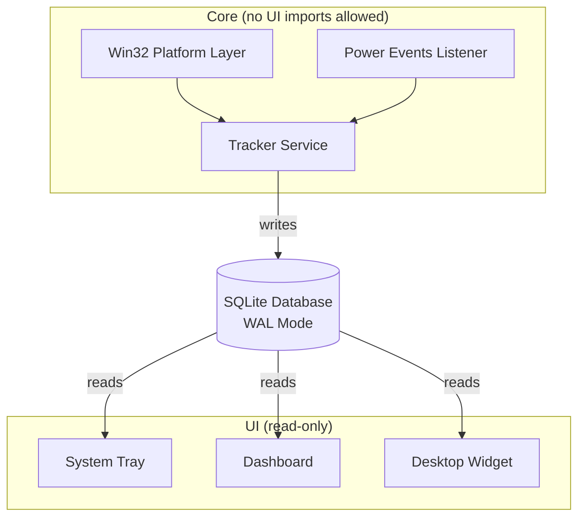
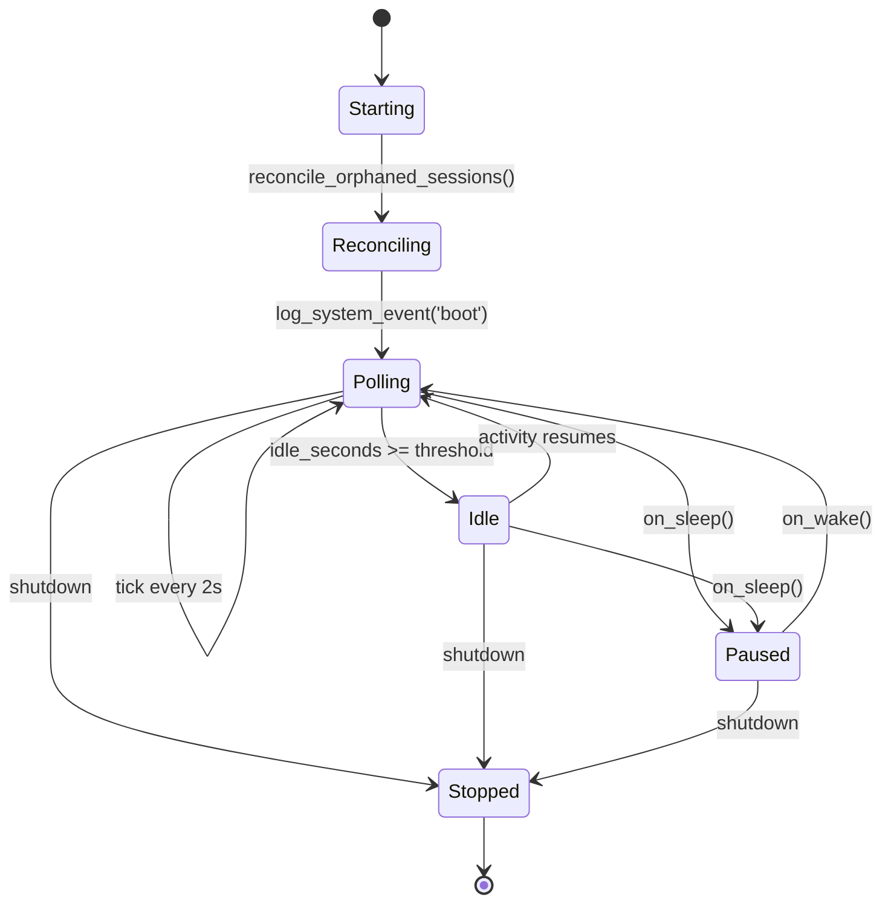
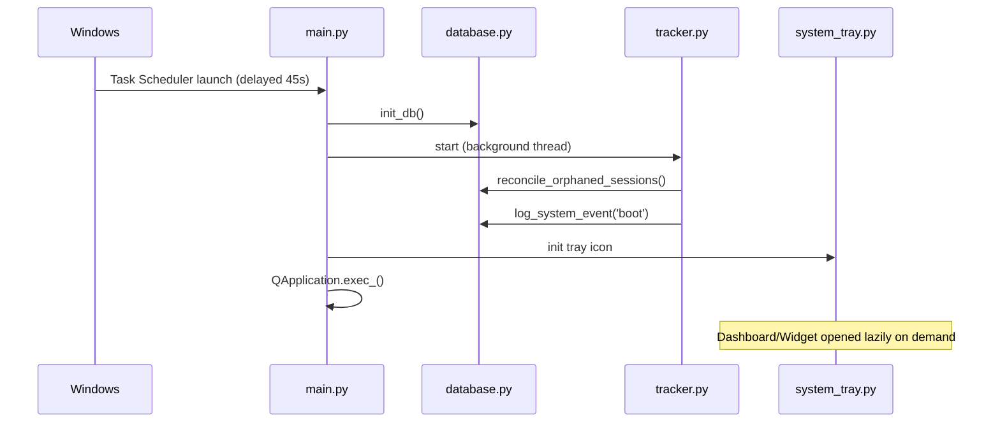
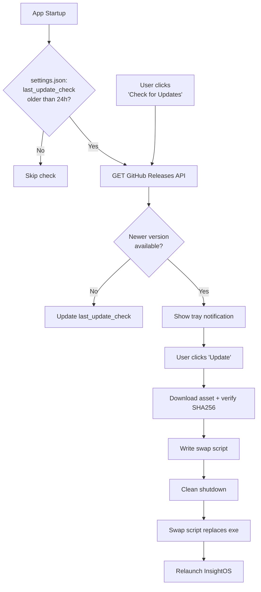

# InsightOS — Architecture

> **Status:** ✅ Frozen
> This document is the single source of truth for InsightOS. Every implementation, pull request, and code review must conform to it. Changes to this document require explicit maintainer approval before any related code is merged.

**Tagline:** Android Digital Wellbeing for Windows.

InsightOS answers five questions, and nothing more:

- How long did I use my laptop?
- Which applications did I use?
- When did I use them?
- What did yesterday look like?
- What does this week/month look like?

It is **not** a productivity coach, an AI assistant, or a RescueTime/Rize alternative. It has no opinions about how you spend your time — it only records it.

---

## Table of Contents

1. [Core Principles](#1-core-principles)
2. [V1 Feature Scope](#2-v1-feature-scope)
3. [Tech Stack](#3-tech-stack)
4. [System Architecture](#4-system-architecture)
5. [Folder Structure](#5-folder-structure)
6. [File Responsibilities](#6-file-responsibilities)
7. [SQLite Schema](#7-sqlite-schema)
8. [Tracker Lifecycle](#8-tracker-lifecycle)
9. [Application Lifecycle](#9-application-lifecycle)
10. [System Tray](#10-system-tray)
11. [Desktop Widget](#11-desktop-widget)
12. [Dashboard](#12-dashboard)
13. [Updater](#13-updater)
14. [Startup Sequence](#14-startup-sequence)
15. [Shutdown Sequence](#15-shutdown-sequence)
16. [Threading Model](#16-threading-model)
17. [Privacy](#17-privacy)
18. [Memory Optimization Strategy](#18-memory-optimization-strategy)
19. [CPU Optimization Strategy](#19-cpu-optimization-strategy)
20. [Exception Handling Strategy](#20-exception-handling-strategy)
21. [Logging Strategy](#21-logging-strategy)
22. [Engineering Rules](#22-engineering-rules)
23. [GitHub Project Structure](#23-github-project-structure)
24. [README Structure](#24-readme-structure)
25. [Roadmap](#25-roadmap)
26. [Performance Budget](#26-performance-budget)
---

## 1. Core Principles

**Privacy First**
No login, no account, no cloud, no telemetry, no analytics server. All data stays on the user's machine, forever, unless the user explicitly exports it. See [§17](#17-privacy) for the full guarantee.

**Lightweight**
Target: **< 30 MB RAM**, **< 0.2% CPU**, smooth on a 4 GB RAM Intel U-series laptop with an HDD or SSD.

**Reliability Over Polish**
Tracking correctness matters more than UI correctness. The Dashboard may have bugs; the Tracker must not. Closing any window must never stop tracking — only "Exit InsightOS" from the tray does that.

**Open Source First**
InsightOS aims to be the reference open-source Digital Wellbeing app for Windows. Code must be simple enough for a first-time contributor to read a single file and understand it completely.

---

## 2. V1 Feature Scope

**Tracker**
Windows startup · background service · foreground application tracking · idle detection · sleep/wake detection · shutdown detection · daily screen time · per-app usage.

**History**
Today · Yesterday · Last 7 Days · Last 30 Days.

**UI**
Dashboard · Desktop Widget · System Tray.

**Explicitly out of scope for v1 (and not implied elsewhere in this document):**
AI, deep work detection, productivity score, focus score, recommendations, website/content classification, machine learning, cloud sync.

---

## 3. Tech Stack

| Layer | Choice | Reasoning |
|---|---|---|
| Language | Python 3.11+ | Fast to write, easy for contributors, sufficient performance for this workload |
| GUI | PySide6 | Native look, good theming, lean enough to hit the RAM budget when Dashboard and Widget aren't both open |
| Database | SQLite (WAL mode) | Zero-config, single-file, safe for one writer + multiple readers |
| Updater | GitHub Releases API | No infrastructure to maintain, fits the "no server" privacy principle |
| Packaging | PyInstaller | Single `.exe`, no Python install required for end users |
| Autostart | Windows Task Scheduler | Supports delayed start and clean registration, safer than a Registry Run key |

---

## 4. System Architecture

The Tracker is the only component that writes data. Every UI surface only reads. This is the one rule the entire codebase is built around.



**Non-negotiable rule:** closing the Dashboard or the Widget never affects the Tracker. Only the tray's "Exit InsightOS" action terminates the process.

---

## 5. Folder Structure

```
InsightOS/
│
├── main.py                          # Entry point — orchestrates the boot sequence
├── config.py                        # All constants and tunables (single source of truth)
├── version.py                       # __version__ string
│
├── core/
│   ├── __init__.py
│   ├── models.py                    # Dataclasses: AppSession, IdlePeriod, SystemEvent, DailySummary
│   ├── database.py                  # SQLite connection, schema, migrations, all queries
│   ├── tracker.py                   # Foreground app + idle polling loop
│   ├── power_events.py              # Sleep / Wake / Shutdown OS signal handling
│   └── platform_win.py              # All raw Win32 / ctypes calls, isolated in one place
│
├── ui/
│   ├── __init__.py
│   ├── system_tray.py               # Tray icon, menu, keep-alive anchor
│   ├── dashboard/
│   │   ├── __init__.py
│   │   ├── dashboard_window.py      # Window shell, tab container
│   │   ├── today_view.py            # Today tab
│   │   ├── history_view.py          # Yesterday / 7-day / 30-day tabs
│   │   └── widgets_common.py        # Shared small UI components
│   └── desktop_widget.py            # Floating always-on-top mini overlay
│
├── services/
│   ├── __init__.py
│   ├── updater.py                   # GitHub Releases check, download, safe-swap, restart
│   └── autostart.py                 # Task Scheduler registration
│
├── utils/
│   ├── __init__.py
│   ├── time_utils.py                # Duration formatting, date bucketing, ISO helpers
│   ├── logger.py                    # Rotating file logger setup
│   └── settings_store.py            # Small local settings.json (widget position, toggles, last_update_check)
│
├── data/                            # Runtime-created, git-ignored
│   ├── insightos.db
│   └── logs/insightos.log
│
├── assets/
│   ├── icon.ico
│   └── tray_icon.png
│
├── installer/
│   ├── build_exe.spec               # PyInstaller spec
│   └── register_task.py             # Task Scheduler setup script
│
├── tests/
│   ├── test_database.py
│   ├── test_tracker.py
│   └── test_time_utils.py
│
├── .github/workflows/release.yml    # Tag push → build → GitHub Release
├── requirements.txt
├── LICENSE
├── README.md
└── CONTRIBUTING.md
```

---

## 6. File Responsibilities

| File | Responsible for | Must NOT contain |
|---|---|---|
| `main.py` | Boot order and shutdown orchestration only | Business logic, DB queries |
| `config.py` | Paths, intervals, thresholds, URLs — all constants | Any logic |
| `version.py` | `__version__` string only | — |
| `core/models.py` | Plain dataclasses mirroring DB rows | SQL, I/O |
| `core/database.py` | **The only place SQL exists.** Schema, migrations, all CRUD | Tracking logic, formatting for display |
| `core/tracker.py` | Polling loop, session open/close decisions | Direct Win32 calls (delegated), UI imports |
| `core/power_events.py` | Translates OS sleep/wake/shutdown signals into tracker callbacks | DB writes (calls tracker instead) |
| `core/platform_win.py` | All ctypes/pywin32 calls, isolated | Business logic |
| `ui/system_tray.py` | Tray icon, menu, launching other UI | Tracking logic, DB writes |
| `ui/dashboard/*.py` | Rendering data fetched from `database.py` | Business logic, DB writes |
| `ui/desktop_widget.py` | Rendering a small read-only overlay | Tracking logic |
| `services/updater.py` | Update check/download/swap/restart | Runs only at startup or on demand — never a background loop |
| `services/autostart.py` | Task Scheduler registration/removal | — |
| `utils/time_utils.py` | Formatting and date math | DB, UI |
| `utils/logger.py` | Logger configuration | — |
| `utils/settings_store.py` | Reads/writes local `settings.json` (app config, not tracked data) | — |

---

## 7. SQLite Schema

```sql
PRAGMA journal_mode = WAL;
PRAGMA synchronous = NORMAL;
PRAGMA foreign_keys = ON;

CREATE TABLE IF NOT EXISTS system_events (
    id          INTEGER PRIMARY KEY AUTOINCREMENT,
    event_type  TEXT NOT NULL CHECK (event_type IN ('boot','shutdown','sleep','wake')),
    timestamp   TEXT NOT NULL,               -- ISO8601 UTC
    created_at  TEXT NOT NULL DEFAULT (datetime('now'))
);

CREATE TABLE IF NOT EXISTS app_sessions (
    id                INTEGER PRIMARY KEY AUTOINCREMENT,
    app_name          TEXT NOT NULL,          -- e.g. "chrome.exe"
    window_title      TEXT,                   -- stored in DB only, never logged to disk
    start_time        TEXT NOT NULL,
    end_time          TEXT,                   -- NULL = currently active session
    duration_seconds  INTEGER,                -- set on close, never recomputed later
    date              TEXT NOT NULL           -- 'YYYY-MM-DD' local date
);

CREATE TABLE IF NOT EXISTS idle_periods (
    id                INTEGER PRIMARY KEY AUTOINCREMENT,
    start_time        TEXT NOT NULL,
    end_time          TEXT,
    duration_seconds  INTEGER,
    date              TEXT NOT NULL
);

CREATE TABLE IF NOT EXISTS daily_summary (
    date                  TEXT PRIMARY KEY,
    total_screen_seconds  INTEGER NOT NULL DEFAULT 0,
    total_idle_seconds    INTEGER NOT NULL DEFAULT 0,
    first_activity        TEXT,
    last_activity         TEXT
);

CREATE INDEX IF NOT EXISTS idx_app_sessions_date   ON app_sessions(date);
CREATE INDEX IF NOT EXISTS idx_app_sessions_active ON app_sessions(end_time) WHERE end_time IS NULL;
CREATE INDEX IF NOT EXISTS idx_idle_periods_date   ON idle_periods(date);

CREATE TABLE IF NOT EXISTS schema_version (
    version INTEGER NOT NULL
);
```

**Notes**
- All timestamps are stored in UTC ISO8601. Conversion to local time happens only in `time_utils.py` at display time.
- `duration_seconds` is always written at close-time, never derived later from timestamps — this keeps closed rows correct even after a crash.
- `schema_version` exists from day one so future migrations don't require a retrofit.

---

## 8. Tracker Lifecycle



**Each tick:**
1. Read idle seconds via `platform_win.get_idle_seconds()`.
2. If idle time crosses the threshold, close the active app session and open an idle period.
3. Otherwise, close any open idle period, detect a foreground-app change, close/open sessions accordingly, and increment `daily_summary`.

**Crash resilience:** on the next launch, `reconcile_orphaned_sessions()` closes any row left with `end_time IS NULL` from a previous date, using its own `start_time`, so a crash never inflates today's numbers with stale data.

---

## 9. Application Lifecycle



Dashboard windows are destroyed on close (opened infrequently). The Widget is hidden, not destroyed, on close (toggled frequently) to avoid reconstruction cost.

---

## 10. System Tray

The tray icon is the persistent anchor of the application — as long as it exists, the app is running.

```
InsightOS  [icon]
├── Open Dashboard
├── ☐ Show Widget
├── ─────────────
│  Today: 3h 42m           (disabled label, refreshed ~every 30s)
├── ─────────────
├── Check for Updates
└── Exit InsightOS
```

- Left-click / double-click → opens Dashboard.
- **"Exit InsightOS"** shows a confirmation dialog ("This will stop usage tracking. Continue?") and is the *only* action that terminates the process.
- Tooltip shows current app + today's total, throttled to avoid per-mouse-move refresh.
- Icon is static — no animation, no per-tick redraw.

---

## 11. Desktop Widget

A small, optional, always-on-top, frameless overlay. Simple, minimal, read-only.

```
┌───────────────────────┐
│  Today                │
│  3h 42m                │
│                        │
│  Current App           │
│  VS Code               │
│  00:42:18               │
│                        │
│  [ Open Dashboard ]     │
└───────────────────────┘
```

- **Today** — total screen time so far today.
- **Current App** — friendly name of the active foreground app, plus a live running duration for the current session.
- **Open Dashboard** — a single button/click target that opens the Dashboard.
- Refreshes every 5 seconds via a `QTimer`, reading only `database.get_today_summary()` and `database.get_active_session()`.
- Draggable by click-and-hold; final position saved to `settings.json` on release.
- Right-click → "Open Dashboard" / "Hide Widget".
- No settings, no charts, no interactivity beyond dragging and opening the Dashboard — that complexity belongs to the Dashboard, not the widget.
- 100% read-only: it has no code path capable of writing to the database.

---

## 12. Dashboard

**Today tab**
- Total Screen Time
- Current Running App (live, refreshes only while the window is visible)
- Top Apps Today (top 5, with duration bars)
- Daily Timeline (segmented strip of app-switch blocks across the day)

**History tab**
- Sub-views: Yesterday · Last 7 Days · Last 30 Days
- Each shows total screen time, a per-day bar chart, and top apps for that range
- Range totals are read from `daily_summary`; per-app breakdowns are grouped from `app_sessions` — no live recomputation of raw idle data.

**General rules**
- Fully read-only. No settings or editing beyond the widget-visibility toggle and "Check for Updates."
- The refresh timer pauses when the window is minimized or not visible, to respect the CPU budget.
- Closing the window (`X`) only destroys the window — it never touches the tracker.

---

## 13. Updater

The updater performs **at most one network request per day** unless the user explicitly asks for more.



- `last_update_check` (ISO8601) is stored in `settings.json` via `settings_store.py`.
- Automatic checks are skipped if the last check was under 24 hours ago.
- The manual **"Check for Updates"** tray action always bypasses the timer.
- Any network, parsing, or checksum failure is logged and silently ignored — the app never blocks or nags on updater failure.
- No update is ever applied without an explicit user click.
- This is the **only** network-capable code path in the entire application.

---

## 14. Startup Sequence

```
Windows Logon
   │
   ▼
Task Scheduler trigger: "At log on of any user", 45s delay
   │  (delay avoids competing with boot-time disk I/O)
   ▼
InsightOS.exe launches silently (no window flash)
   │
   ▼
Process priority set to BELOW_NORMAL
   │
   ▼
main.py boot sequence (§9)
   │
   ▼
Tray icon appears — nothing else visible
```

Task Scheduler is used instead of a Registry Run key because it supports delayed start, doesn't fight early-boot I/O, and can be cleanly registered/unregistered by `services/autostart.py` without touching the registry directly.

---

## 15. Shutdown Sequence

Two paths converge on the same clean-close routine:

- **User-initiated:** Tray → "Exit InsightOS" → confirmation dialog → `main.shutdown()`
- **OS-initiated:** Windows shutdown/logoff signal → `power_events` listener → `main.shutdown()`

```
main.shutdown():
 1. tracker.stop_polling()
 2. tracker.close_active_session_and_idle("now")
 3. database.log_system_event('shutdown')
 4. database.checkpoint_and_close()   # WAL checkpoint before close
 5. QApplication.quit()
```

All steps are synchronous, local, and fast — safe to complete within Windows' shutdown grace window.

---

## 16. Threading Model

| Thread | Owns | Notes |
|---|---|---|
| Main thread (Qt event loop) | Tray, Dashboard, Widget, power-event message pump | All UI must live here |
| Tracker thread | The polling loop | Never touches Qt widgets; only writes to SQLite |
| Updater thread | Async GitHub check + download | Spawned on demand; signals the main thread when done |

**Rule:** the tracker thread never calls into `ui/` directly. If the tray needs a liveness signal, it reads state from `database.py`, never via a direct method call — keeping the dependency arrow strictly one-directional (UI → DB ← Tracker).

SQLite is accessed safely from multiple threads under WAL mode as long as each thread uses its own connection. `database.py` exposes a `get_connection()` that returns a thread-local connection.

---

## 17. Privacy

InsightOS makes the following guarantees, and they are considered architectural invariants, not preferences:

- ❌ No login
- ❌ No account
- ❌ No telemetry
- ❌ No analytics server
- ❌ No cloud sync
- ❌ No collection of user data by anyone other than the user themselves
- ✅ All tracked data is stored locally in a single SQLite file the user fully owns
- ✅ The **only** network request in the entire application is the GitHub Releases check described in [§13](#13-updater)
- ✅ Everything else — tracking, storage, dashboard, widget, tray — operates fully offline

Any pull request that introduces a new network call outside `services/updater.py` must be rejected on sight.

---

## 18. Memory Optimization Strategy

- Single process, single interpreter — no subprocess spawning for tracking.
- Dashboard is destroy-on-close; only the tray, tracker, and (optionally) widget stay resident.
- No ORM — raw `sqlite3` with parameterized queries, avoiding the overhead of an object graph for a schema this simple.
- No in-memory caching of historical data — every read goes straight to SQLite, which is fast enough at this data volume.
- Minimal asset footprint — small tray/widget icons only, no sprite sheets.
- Log rotation capped (5 MB × 3 files) so logging can never cause unbounded growth.

---

## 19. CPU Optimization Strategy

- Polling interval defaults to 2 seconds; no expensive hook-based focus tracking.
- Idle detection reuses the cheap `GetLastInputInfo()` call — no keyboard/mouse hooking.
- Dashboard refresh pauses when its window isn't visible; Widget refresh is throttled to 5 seconds.
- Tray label/tooltip refresh throttled to ~30 seconds, decoupled from the tracker's 2-second tick.
- Process priority set to `BELOW_NORMAL` so the OS deprioritizes InsightOS under contention.
- Every interval or sleep value is defined once in `config.py` — never hardcoded elsewhere.

---

## 20. Exception Handling Strategy

- **Tracker loop:** each tick is wrapped in try/except; a single failed tick is logged and skipped, never crashes the loop.
- **Database layer:** write functions catch `sqlite3.OperationalError`, retry once with backoff, then log and drop that single write rather than crash.
- **UI / power events:** exceptions in a Qt slot are caught and logged at the slot boundary; they never propagate into the Qt event loop.
- **Updater:** every network/file operation is individually try/except-wrapped; failure aborts only the update flow.
- **Global safety net:** `main.py` installs a `sys.excepthook` that logs any unhandled exception with a full traceback before exit, so no crash is ever silent.

---

## 21. Logging Strategy

- A single rotating file logger (`utils/logger.py`); every module uses `logging.getLogger(__name__)`.
- Location: `data/logs/insightos.log`, rotated at 5 MB, 3 backups kept.
- **`INFO`** — lifecycle events only (boot, shutdown, sleep, wake, daily summaries). Individual session open/close events are *not* logged — too noisy, and already durably recorded in SQLite.
- **`WARNING`** — recoverable errors (skipped tick, DB write retry).
- **`ERROR`** — anything caught by the global exception hook.
- **Window titles are never written to the log file**, by default or otherwise — only executable names and lifecycle events are logged. Window titles exist only inside the SQLite database, which the user fully controls.
- Logging is 100% local — never transmitted anywhere.

---

## 22. Engineering Rules

These rules are mandatory. Every future implementation must obey them without exception.

1. Every file must have **one** responsibility.
2. Target file size: **200–300 lines**. Hard limit: **400 lines**. Any file exceeding 400 lines must be split into smaller modules.
3. Maximum function size: **40 lines**.
4. No circular imports.
5. UI must **never** import Tracker.
6. Tracker must **never** import UI.
7. Business logic must **never** live inside UI files.
8. Database queries must exist **only** inside `database.py`.
9. No duplicated logic — shared behavior belongs in `utils/`.
10. No hardcoded values — all configurable values belong in `config.py`.
11. Every public class and function must include **type hints** and a **docstring**.
12. All modules must be independently testable (no hidden global state that blocks unit testing).
13. Keep the project beginner-friendly — a new open-source contributor should be able to read one file and understand it without needing the whole codebase in their head.

---

## 23. GitHub Project Structure

```
Repository: InsightOS
├── main branch (protected, releases tagged from here)
├── .github/
│   ├── workflows/release.yml     # tag push → PyInstaller build → GitHub Release with .exe + SHA256SUMS
│   ├── ISSUE_TEMPLATE/
│   └── PULL_REQUEST_TEMPLATE.md
├── docs/
│   └── ARCHITECTURE.md           # this document
├── LICENSE                       # MIT
├── CONTRIBUTING.md
├── CHANGELOG.md
└── README.md
```

Releases are tag-triggered (`v1.0.0`, `v1.1.0`, …). CI builds the PyInstaller executable and attaches it plus a `SHA256SUMS` file to the GitHub Release — the same artifact `services/updater.py` consumes.

---

## 24. README Structure

```
# InsightOS
Tagline + screenshot/GIF of Dashboard and Widget

## What it is / isn't
## Features (v1)
## Privacy
   (explicit guarantee list, link to ARCHITECTURE.md §17)
## Installation
   - Download from Releases
   - (future) winget/choco package
## Building from source
## Architecture
   - Link to docs/ARCHITECTURE.md
   - The core diagram: Tracker → SQLite → {Dashboard, Widget, Tray}
## Roadmap
## Contributing
## License
```

---

## 25. Roadmap

**v1.0 — Track First**
Everything specified in this document: foreground tracking, idle/sleep/wake/shutdown detection, SQLite storage, Today/History dashboard, widget, tray, GitHub-Releases updater. No AI, no scoring, no cloud.

**v1.1 — Polish & Depth**
- Export data (CSV/JSON) — portability, not analysis
- Per-app icons in Dashboard/Widget
- Weekly summary view
- Multi-monitor-aware widget positioning
- Configurable idle threshold and poll interval via a simple settings panel
- Portable/no-install build option

**v2.0 — Optional, Still Local-Only**
- User-defined category tags for apps (manual, not AI-classified) for chart grouping
- Local historical trend charts beyond 30 days
- Local backup/restore of the SQLite file (export/import to a user-chosen folder — still no cloud)
- Linux/macOS tracker backends behind the same `platform_win.py`-style abstraction, if there's community demand

No version of InsightOS introduces AI, scoring, recommendations, or any network endpoint beyond the GitHub Releases updater check defined in §13.

---

# 26. Performance Budget

InsightOS is designed to be an extremely lightweight Windows background application.

Every implementation must stay within these targets.

## Tracker (Background)

| Metric | Target |
|---------|--------|
| RAM Usage | < 20 MB |
| CPU Usage | < 0.2% average |
| Disk Writes | Batched, minimal |
| Startup Time | < 2 seconds |
| Shutdown Time | < 1 second |

---

## Dashboard

| Metric | Target |
|---------|--------|
| RAM Usage | < 80 MB while open |
| CPU Usage | < 2% while visible |
| CPU Usage | ~0% when hidden/closed |
| Refresh Rate | Every 5 seconds |

---

## Desktop Widget

| Metric | Target |
|---------|--------|
| RAM Usage | < 15 MB |
| CPU Usage | < 0.1% |
| Refresh Rate | Every 5 seconds |

---

## SQLite

- WAL Mode enabled.
- One writer.
- Multiple readers.
- Thread-local connections only.
- No ORM.
- Parameterized queries only.
- Indexed tables only where required.

---

## Code Quality Budget

Every Pull Request must satisfy:

- No file should exceed **300 lines** (400 absolute maximum).
- No function should exceed **40 lines**.
- No duplicated logic.
- No unnecessary allocations.
- No busy waiting.
- No memory leaks.
- No UI blocking operations.
- Long-running work must never execute on the UI thread.

---

## Performance Philosophy

InsightOS should feel invisible.

Users should forget it is running.

Tracking accuracy is more important than visual effects.

Performance is more important than unnecessary abstractions.

Simplicity is preferred over complexity.

Measure first. Optimize second.

---

*This architecture is frozen. Implementation proceeds one module at a time, starting with `config.py`, followed by `core/models.py` and `core/database.py`.*
